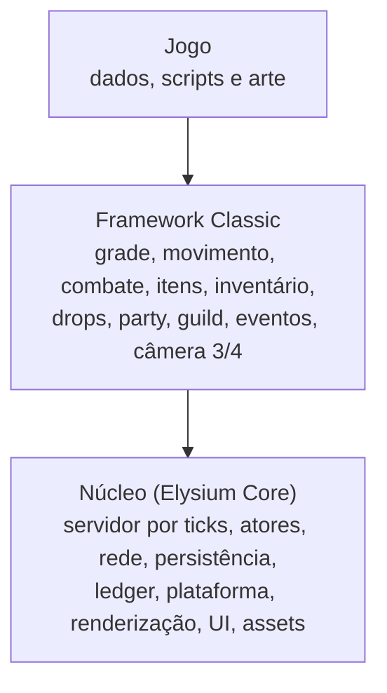
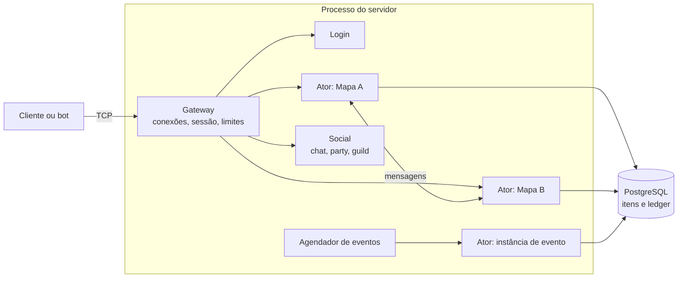
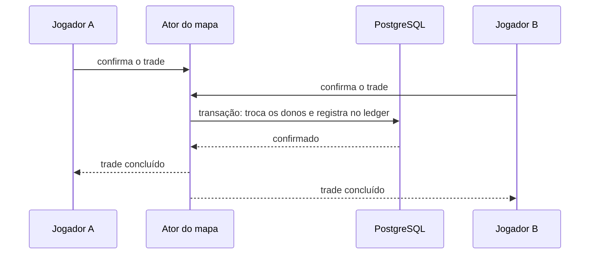

# Arquitetura

> Documento vivo: descreve como o sistema **é agora** e para onde vai. É atualizado no mesmo PR que muda o que ele descreve. Os porquês das decisões estão nos [ADRs](adr/README.md).

## Visão geral

Uma engine de MMORPG tem quatro partes, em ordem de importância:

1. **Servidor de simulação:** autoridade sobre tudo (movimento, combate, drops, economia).
2. **Framework de gênero (Classic):** as mecânicas do estilo clássico como peças configuráveis.
3. **Conteúdo e operação ao vivo:** dados de itens, monstros, spawns e eventos, editáveis e recarregáveis com o servidor rodando.
4. **Cliente:** renderização, UI e efeitos. É um terminal bonito e não confiável.

## Camadas

| Camada | Sabe | Não sabe |
|---|---|---|
| Núcleo | rodar um servidor autoritativo por ticks, guardar dados com segurança, trocar mensagens, desenhar na tela | o que é um item, uma espada ou uma party |
| Classic | as mecânicas do gênero, configuradas por dados | nada de um jogo específico |
| Jogo | os números, as regras, os textos e a arte | — |

As dependências só descem (INV-02). Cada camada é um conjunto de projetos .NET, e o compilador e os testes de arquitetura garantem a direção. O Classic é oficial e vem com a engine, mas cada peça dele pode ser estendida ou trocada por um desenvolvedor sem mexer no núcleo.

## Estrutura de projetos

| Pasta | Projetos | Camada |
|---|---|---|
| `src/core/` | `Elysium.Core`, `Elysium.Core.Server`, `Elysium.Core.Client` | Núcleo |
| `src/framework/` | `Elysium.Classic.Shared`, `Elysium.Classic.Server` (e `Elysium.Classic.Client` a partir da fatia 1) | Classic |
| `samples/` | `Elysium.Demo.*` (a partir da fatia 0) | Jogo |
| `tools/` | `Elysium.Checks`, `Elysium.Bot` (a partir da fatia 0) | Ferramentas |
| `tests/` | `<Projeto>.Tests`, `Elysium.Architecture.Tests` | Testes |

Regras de dependência:

- O núcleo não referencia o Classic; o Classic não referencia projetos de jogo.
- `*.Shared` não referencia `*.Server` nem `*.Client`.
- `*.Server` e `*.Client` não se referenciam.
- Um projeto novo só nasce quando existe um motivo real (ver a regra de três em [CONVENTIONS.md](CONVENTIONS.md#regra-de-três)).

## Servidor

### Modelo de execução: um mapa, um ator

- Cada mapa, ou instância de evento, é um **ator single-threaded**, com o próprio loop de tick e a própria fila de mensagens. Dentro do mapa não há locks.
- O paralelismo vem de rodar muitos mapas ao mesmo tempo, num pool de threads.
- Mapas conversam só por mensagens assíncronas (teleporte, whisper, convite de party).
- O tick é configurável entre 10 e 20 por segundo; o cliente interpola entre um tick e outro.
- A simulação é determinística: o tempo vem do relógio do tick e os sorteios vêm do RNG do servidor. Os dois podem ser trocados nos testes.

### Topologia: um processo, vários módulos

No início, tudo roda **num processo só**. Login, mapas, serviços sociais e agendador de eventos são módulos dentro dele, e o PostgreSQL fica ao lado. Os módulos conversam por interfaces e mensagens, para que qualquer um deles possa virar um processo separado quando uma medição pedir.

### Área de interesse (AOI)

- Uma grade espacial alinhada à grade de tiles.
- Quando alguém se move, o servidor calcula quem entrou e quem saiu do campo de visão e envia a criação e a remoção dessas entidades.
- Prioridade por distância e por relevância (o alvo, a party, quem está atacando), com atualizações menos frequentes para o que está longe.
- O cerco, com centenas de jogadores numa mesma área, é o cenário de referência: limite de entidades por campo de visão, eventos agrupados por tick e cálculo de AOI em paralelo quando o mapa estiver lotado.

### Autoridade

- **Movimento:** o cliente envia o destino. O servidor valida cada passo na grade e também o tempo, pela velocidade do personagem.
- **Combate:** o cliente pede "usar a skill X no alvo Y". O servidor confere alcance, cooldown, mana e linha de visão, calcula o resultado e o transmite. O cliente pode começar a animação na hora, mas o número vem do servidor.
- **Sorteios** (drops, upgrade, combinação de itens) existem só no servidor.
- A segurança não depende de o código ser secreto. O repositório é público.

### Persistência e economia

Os itens são a economia do jogo. As regras são estas ([ADR 0004](adr/0004-persistencia-anti-dupe.md)):

1. Todo item é **uma linha própria** no banco, com ID global único e **um único dono**: um personagem, o chão, um baú, uma loja, o correio ou o sistema.
2. Toda troca de dono que envolve outro jogador, ou algo que outro jogador pode acessar (trade, item jogado no chão, baú compartilhado, loja pessoal, correio, leilão), é **uma transação no banco**. Ela é confirmada antes de o resultado aparecer para os jogadores.
3. Mudanças internas, como mover um item dentro do próprio inventário ou pegar o drop de um monstro, ficam em memória e entram no snapshot.
4. O **snapshot** de um mapa grava todos os personagens do mapa **no mesmo tick, numa única transação**.
5. Todo nascimento, transferência e destruição de item é registrado no **ledger**, que só aceita novos registros.
6. Na troca de mapa, um **lease de posse** garante que o personagem existe em um só ator. Mensagens para o dono antigo são rejeitadas.

O PostgreSQL é a fonte da verdade a partir da fatia 2. Antes disso, uma implementação em memória fica atrás da mesma interface. Um cache (como Redis) nunca é a fonte da verdade da economia.

## Rede

- **TCP primeiro**, atrás de uma interface de transporte. UDP, QUIC ou WebSocket entram só se uma medição pedir ([ADR 0005](adr/0005-tcp-primeiro.md)).
- Criptografia de verdade (TLS) antes de qualquer teste aberto ao público.
- As mensagens são tipos C# na biblioteca compartilhada, com serialização gerada na compilação. O protocolo tem **versão explícita** (INV-11).
- Envio só do que mudou, posições na grade em formato compacto e mensagens agrupadas por tick.

## Conteúdo e lógica de jogo

- Itens, monstros, skills, drops, receitas, mapas e eventos são **dados** com schema. Eles são validados ao serem importados, ficam em texto versionado no Git e viram binário na hora do build de conteúdo.
- Um dado inválido (por exemplo, um drop que aponta para um monstro que não existe) é erro de validação, nunca erro em produção.
- Dados e scripts recarregam com o servidor rodando.
- A lógica de jogo (quests, eventos, chefes) é escrita em **C#**. A forma de carregar e recarregar essa lógica é decidida quando a primeira lógica de jogo surgir.
- O cliente recebe só o que precisa: fórmulas para os tooltips, sim; tabelas de drop e chances internas, não (INV-14).

## Cliente

- **Cliente = núcleo do cliente + gráficos + entrada + UI.** O núcleo do cliente (conexão, login, protocolo, entidades visíveis, estado do jogador) é o mesmo que o bot usa.
- **Camada de plataforma:** janela, entrada, arquivos, áudio e API gráfica ficam atrás de uma camada própria. Windows primeiro, sem nada que feche as portas de Linux e mobile (INV-12). Os testes rodam em Windows e em Linux.
- **Renderização:** forward+ (clustered forward), adequado a muita transparência aditiva e a muitas luzes pequenas. Skinning na GPU com instancing por peça, partículas na GPU, qualidade reduzida para personagens e efeitos distantes, e um orçamento de personagens visíveis com prioridade. A biblioteca gráfica (a candidata é o SDL3 GPU) é escolhida na fatia 1, com protótipo e ADR.
- **Desempenho:** o loop do frame não aloca memória, e isso é medido em teste. A cena de referência do cerco precisa rodar no PC mínimo.
- **UI:** retained-mode, com data binding e skins.
- **Patcher (mais à frente):** pacotes de conteúdo identificados por hash e patches que baixam só a diferença.

## Invariantes

Regras que nenhuma mudança pode violar. Sempre que possível, cada uma é garantida por teste, analisador ou checagem automática.

| ID | Invariante | Garantia |
|---|---|---|
| INV-01 | O cliente nunca decide: regras, sorteios e validações acontecem no servidor | revisão e testes do servidor |
| INV-02 | As dependências entre camadas só descem: Jogo → Classic → Núcleo | testes de arquitetura |
| INV-03 | Cada mapa é um ator single-threaded; não há estado mutável compartilhado entre mapas; a comunicação é só por mensagens | APIs proibidas e revisão |
| INV-04 | A simulação é determinística: o tempo vem do relógio do tick e os sorteios do RNG do servidor | APIs proibidas (`DateTime.Now`, `Random`…) |
| INV-05 | Todo item tem ID global único e exatamente um dono | restrição no banco e testes |
| INV-06 | Uma troca de dono que envolve outro jogador é uma transação confirmada antes de o resultado aparecer | testes de dupe |
| INV-07 | Todo nascimento, transferência e destruição de item vai para o ledger | testes |
| INV-08 | Um personagem existe em um só ator por vez (lease de posse) | testes |
| INV-09 | O snapshot de um mapa grava todos os personagens no mesmo tick, numa única transação | testes |
| INV-10 | Núcleo e Classic não contêm nomes, números ou regras de um jogo específico | revisão e testes de arquitetura |
| INV-11 | O protocolo tem versão explícita; uma mudança incompatível muda a versão | testes de protocolo |
| INV-12 | Núcleo e Classic não falam diretamente com o sistema operacional; tudo passa pela camada de plataforma | testes em Linux e revisão |
| INV-13 | O código é compatível com NativeAOT: sem reflexão dinâmica nem geração de código em tempo de execução | analisadores de AOT |
| INV-14 | O cliente só recebe os dados de que precisa | revisão |
| INV-15 | Nenhum segredo entra no repositório | hook de pre-commit e detecção do GitHub |
