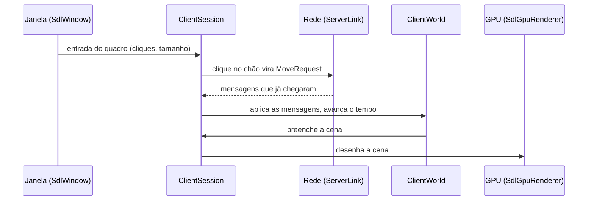

# Módulo: cliente

> Documento vivo. Nasceu na fatia 1 e é atualizado no mesmo PR que muda o sistema.

## Responsabilidade

Mostra o mundo que o servidor descreve e leva ao servidor o que o jogador pede. Conecta e faz o login, recebe as mensagens em segundo plano, desliza os personagens entre os tiles confirmados, segue o próprio personagem com a câmera 3/4, transforma o clique no chão em pedido de destino e desenha a cena na janela. Ele **não** decide nada (INV-01): não acha caminho, não valida destino e não prevê movimento. Ainda não tem interface, texto na janela, modelos 3D, animação nem som.

## Onde fica

| Projeto | Camada | Papel |
|---|---|---|
| `Elysium.Core.Client` | Núcleo | ligação com o servidor (`GameConnection`, `ServerLink`); entrada do quadro (`Input`); descrição da cena (`Rendering`) |
| `Elysium.Core.Client.Sdl` | Núcleo | a camada de plataforma: janela e mouse (`SdlWindow`), GPU (`SdlGpuRenderer`, `GpuBlockBuffer`) e os shaders |
| `Elysium.Classic.Client` | Classic | estado do mundo (`World`), movimento suave (`Movement`), câmera e clique (`Camera`), montagem da cena e quadro (`Presentation`) |
| `Elysium.Demo.Shared` | Jogo | o mapa e a velocidade de um passo, os mesmos do servidor |
| `Elysium.Demo.Client` | Jogo | as cores, a câmera e o movimento do jogo (`DemoLook`), o login (`DemoLogin`), o título e o programa |
| `Elysium.Bot` | Ferramenta | usa o mesmo estado do mundo e escreve o que vê em texto |

## Conceitos

- **Ligação com o servidor** (`ServerLink`): depois do login, duas tarefas em segundo plano leem e escrevem na rede. O quadro só tira o que já chegou (`TryTakeMessage`) e pede para enviar (`Send`), sem nunca esperar. Quando a conexão cai, `IsConnected` fica falso e `LostReason` diz por quê.
- **Estado do mundo** (`WorldState`): o próprio personagem e as entidades à vista, cada uma no último tile que o servidor confirmou. Cada mensagem aplicada devolve uma mudança tipada (`WorldChange`: entrou, apareceu, andou, sumiu, destino recusado).
- **Movimento suave** (`WorldMotion`, `TileMotion`): a posição desenhada anda um tile por passo do servidor, nunca passa do último tile confirmado e, se ficar mais de `MaxStepsBehind` passos atrás, pula para alcançar.
- **Câmera e tiles** (`ThreeQuarterCamera`, `TileSpace`, `TilePicker`): o chão é o plano Y = 0, a coluna anda em X e a linha em Z, e cada tile tem uma unidade. O clique vira um raio que sai da câmera; o tile é onde o raio toca o chão, ou o lado ou o topo de um tile bloqueado, que é mais alto.
- **Marca do destino** (`DestinationMark`): aparece no tile clicado, some quando o personagem chega e, se o servidor recusar, mostra a recusa por um tempo.
- **Cena** (`Scene`, `SceneBlock`, `DirectionalLight`): o que desenhar num quadro, só como dados: a câmera, a luz, o fundo e uma lista de blocos coloridos. O jogo preenche, a plataforma desenha; nenhum dos dois conhece o outro.
- **Estilo** (`SceneStyle`): as cores, os tamanhos e a luz vêm do jogo (INV-10).
- **Quadro** (`ClientWorld`, `ClientSession`): o `ClientWorld` junta o estado do mundo, o movimento, a câmera, a marca e a montagem da cena; o `ClientSession` liga isso à rede. Um quadro: os cliques viram `MoveRequest`, as mensagens que chegaram atualizam o mundo, o tempo move os personagens e a cena é preenchida. A janela e os clientes sem janela dos testes rodam exatamente os mesmos quadros.
- **Entrada** (`FrameInput`): os cliques do quadro (em pixels da área de desenho), o tamanho da janela e o pedido de fechar. A plataforma preenche, o jogo lê.
- **Desenho** (`SdlGpuRenderer`): um cubo só, desenhado uma vez por bloco da cena numa chamada (instancing), com uma luz direcional. O SDL escolhe Direct3D 12 ou Vulkan.



## Como usar

O programa `samples/Elysium.Demo.Client/Program.cs` monta tudo: login com `DemoLogin`, um `ClientSession` com o `ClientWorld` do `DemoLook`, e o loop que liga `SdlWindow`, `ClientSession` e `SdlGpuRenderer`. Para rodar:

```bash
dotnet run --project samples/Elysium.Demo.Client -- --name Ana
```

Para mudar um shader: editar o HLSL em `src/core/Elysium.Core.Client.Sdl/Shaders/` e rodar `sh src/core/Elysium.Core.Client.Sdl/Shaders/compile.sh` (precisa do Windows SDK e do Vulkan SDK; ver o ADR 0012).

## Invariantes relevantes

- INV-01: o cliente só pede o destino e nunca desenha um personagem além do último tile confirmado.
- INV-10: cores, tamanhos, câmera, luz e velocidade vêm do jogo (`DemoLook`, `DemoWorld`).
- INV-12: só `Elysium.Core.Client.Sdl` usa o SDL; o teste de arquitetura garante.
- INV-13: o projeto de plataforma usa só chamadas diretas ao SDL, compatíveis com NativeAOT.
- Desempenho: depois de aquecido, um quadro (aplicar as mensagens, mover e montar a cena) não cria memória nova.

## Testes

- `tests/Elysium.Core.Client.Tests`: ligação com o servidor (conexão caída), entrada do quadro e cena.
- `tests/Elysium.Classic.Client.Tests`: estado do mundo, movimento com tempo controlado, câmera e clique em várias posições e tamanhos de janela, marca do destino, montagem da cena e o teste de memória por quadro (`FrameAllocationTests`).
- `tests/Elysium.Demo.Client.Tests`: argumentos, título, login recusado e, de ponta a ponta, dois clientes sem janela contra o servidor de demonstração.
- `tests/Elysium.Architecture.Tests`: só `Elysium.Core.Client.Sdl` usa o SDL.
- A janela e o desenho não rodam na CI, que não tem placa de vídeo: são conferidos pelo dono.

## Itens provisórios

- TD-0010: shaders compilados à mão e guardados no repositório.
- TD-0011: a cena leva o mapa inteiro a cada quadro.
- TD-0012: a velocidade de um passo vem dos dados compartilhados, e não do servidor.
- TD-0013: o cliente lê o mapa embutido no programa, e o servidor não diz qual é o mapa.
