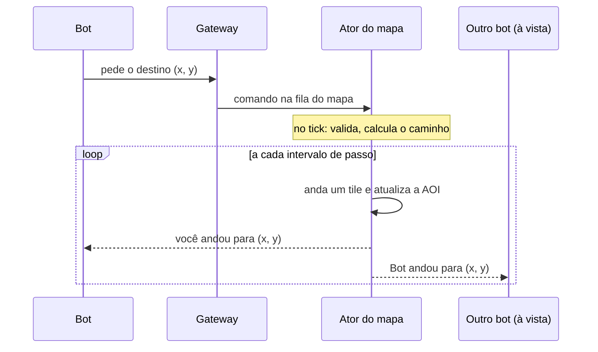

# Plano da fatia 0: Servidor e bots

## Resumo para o dono

Primeiro, a simulação do mapa é construída e testada sozinha, sem rede, com um relógio de teste que avança quando o teste manda: assim cada passo e cada "apareceu/sumiu" é conferido de forma exata e repetível. Depois entram a rede, o login e o bot. Por fim, um teste liga o servidor de verdade e três bots e roda o cenário do roadmap.

## Abordagem

1. **Base de tempo e ticks** (`Elysium.Core`, `Elysium.Core.Server`): a interface do relógio da simulação, o relógio real (o único arquivo com a exceção de API proibida) e o loop de tick de um ator, com a fila de mensagens de entrada.
2. **Protocolo v1** (`Elysium.Core`): mensagens com tamanho no início (*length-prefixed*), tamanho máximo, tipo da mensagem e a versão do protocolo. Leitura e escrita binárias, escritas à mão nesta fatia.
3. **Grade e mapa** (`Elysium.Classic.Shared`): posição em tile, as 8 direções, o mapa com tiles livres e bloqueados, e a leitura do arquivo de mapa com validação.
4. **Simulação do mapa** (`Elysium.Classic.Server`): o ator do mapa recebe comandos (entrar, pedir destino, sair), calcula o caminho (busca em largura na grade, com limite de distância), move um tile a cada intervalo definido pela velocidade e mantém a AOI por células da grade, gerando os eventos "apareceu", "andou" e "sumiu" só para quem está no raio de visão. Testes determinísticos, sem rede.
5. **Gateway e login** (`Elysium.Core.Server`): aceita conexões TCP, lê as mensagens fora do tick, confere a versão e o nome, e repassa comandos ao ator do mapa por mensagens. Fecha a conexão que mandar algo inválido.
6. **Cliente do núcleo** (`Elysium.Core.Client`): conectar, fazer login e trocar mensagens. É a parte que o cliente gráfico da fatia 1 vai reaproveitar.
7. **Bot** (`tools/Elysium.Bot`): usa o cliente do núcleo, guarda o que vê e tem os comandos `walk` e `demo`.
8. **Servidor de demonstração** (`samples/Elysium.Demo.Server`): o programa que junta tudo, com o arquivo do mapa e os números do jogo (ticks por segundo, velocidade, raio de visão, ponto de entrada).
9. **Teste de ponta a ponta:** liga o servidor numa porta livre, roda os três bots e confere o cenário (CA-10).
10. **Documentação:** ARCHITECTURE, o documento do protocolo e do servidor (a partir de `templates/module.md`), código de referência em CONVENTIONS e os itens provisórios em TECH_DEBT.

## Projetos e módulos afetados

| Projeto | O que muda |
|---|---|
| `Elysium.Core` | relógio da simulação, IDs de entidade, protocolo v1 (envelope, versão, leitura e escrita), mensagens de login |
| `Elysium.Core.Server` | relógio real, loop de tick do ator, transporte TCP, gateway e sessões, login |
| `Elysium.Core.Client` | conexão TCP do cliente, login, envio e recebimento de mensagens |
| `Elysium.Classic.Shared` | posição na grade, direções, mapa em grade e leitura do arquivo de mapa, mensagens de movimento e de visibilidade |
| `Elysium.Classic.Server` | ator do mapa, caminho na grade, movimento por velocidade, AOI |
| `samples/Elysium.Demo.Server` (novo) | programa do servidor de demonstração, mapa e números do jogo |
| `tools/Elysium.Bot` (novo) | bot headless com os comandos `walk` e `demo` |
| `tests/*.Tests` (novos) | um projeto de teste para cada projeto que ganha código, mais o teste de ponta a ponta em `Elysium.Demo.Server.Tests` |
| `tests/Elysium.Architecture.Tests` (**trava**) | incluir a referência a `Elysium.Demo.Server`, porque o teste de cobertura exige que todo projeto de `samples/` esteja ali |

## Visão de destino

- **Ator e tick:** o mesmo loop vai rodar muitos mapas e instâncias num pool de threads. Agora há um mapa só, mas o gateway já envia comandos ao mapa pelo ID dele, por mensagens, e nunca chamando o mapa direto. Assim, o segundo mapa e o teleporte com lease de posse entram sem mudar o desenho.
- **Transporte:** o TCP fica atrás de uma interface de transporte (ADR 0005). TLS, e outros transportes se uma medição pedir, entram como novas implementações dela.
- **Protocolo:** o envelope (tamanho, tipo e versão) já é o definitivo. As mensagens são `record`s; quando a serialização passar a ser gerada na compilação, só muda o código que lê e escreve, não as mensagens nem os bytes.
- **Login:** a troca de mensagens do login já tem o formato "pedido → aceito ou recusado com motivo". Conta e senha entram como novos campos numa nova versão do protocolo.
- **AOI:** a grade de células é a estrutura definitiva. Prioridade por distância e limite por campo de visão se somam a ela nas fatias de escala.
- **Bot:** o que o bot sabe sobre o mundo (quem está à vista e onde) é o mesmo estado de que o cliente gráfico precisa. Na fatia 1 isso sai do bot e vai para `Elysium.Classic.Client`, e o bot passa a usá-lo.
- **Dados:** o mapa vem de um arquivo de texto do jogo, validado ao carregar. O formato definitivo de conteúdo (schema, build para binário) entra quando houver mais tipos de dado.

## Simplificações provisórias

| Item provisório | Por que é provisório | Destino |
|---|---|---|
| Serialização das mensagens escrita à mão | são poucas mensagens; o gerador na compilação (ARCHITECTURE, "Rede") vale a pena quando elas se multiplicarem | fatia 2 |
| Login só com o nome do personagem, sem conta nem senha | ainda não há banco de dados para guardar contas | fatia 2 |
| Conexão sem criptografia (TLS) | nada é aberto ao público antes disso (ADR 0005) | fatia 2 |
| Estado do mundo visto pelo bot dentro do próprio bot | `Elysium.Classic.Client` nasce na fatia 1, com o cliente gráfico | fatia 1 |
| Mapa num arquivo de texto simples, sem schema nem build de conteúdo | é o único tipo de dado até agora | fatia 2 |

O dono aprovou os destinos "fatia 2" para o TLS e para o login em 2026-11-17, junto com a spec.

## Decisões e dependências

- **Biblioteca nova (precisa da sua aprovação): `Microsoft.Extensions.Logging`.** É a biblioteca padrão da Microsoft para mensagens de log, compatível com NativeAOT. O servidor precisa mostrar o que está fazendo, e o console é proibido no código do servidor (regra de APIs proibidas). A interface (`Microsoft.Extensions.Logging.Abstractions`) entra no código do servidor; a saída no terminal (`Microsoft.Extensions.Logging.Console`) só no servidor de demonstração. Alternativa sem biblioteca: escrever uma interface de log própria, que daria mais código para manter e seria trocada depois.
- **Mudanças em travas (precisam da sua aprovação):**
  - `Directory.Packages.props`: registrar as versões da biblioteca de log, se aprovada.
  - `tests/Elysium.Architecture.Tests/Elysium.Architecture.Tests.csproj`: incluir o projeto `Elysium.Demo.Server`, para que as regras de camadas valham também para ele. Isso **amplia** a proteção; não a afrouxa.
- **Protocolo (precisa da sua aprovação):** esta fatia cria a versão 1 do protocolo: envelope com tamanho, tipo e versão; login; pedido de destino; e os eventos de entrada, passo e saída de visão. O formato fica documentado no documento do módulo.
- **ADR:** nenhum novo. As decisões já estão nos ADRs 0002 (camadas), 0003 (ator por mapa) e 0005 (TCP).
- **Banco de dados:** nenhuma mudança.

## Riscos

- **Teste de rede instável** (porta ocupada, tempo de espera): o teste de ponta a ponta usa uma porta livre escolhida pelo sistema e espera por eventos com tempo limite, nunca por pausas fixas.
- **Erros de concorrência entre a rede e o tick:** a rede só coloca mensagens na fila do ator; o estado do mapa só muda dentro do tick (INV-03). Os testes da simulação rodam sem rede e sem threads.
- **Simulação não determinística por acidente:** as APIs proibidas impedem o relógio e o `Random` do sistema; o CA-09 compara duas execuções inteiras.
- **Fatia grande:** se a implementação mostrar que ela não cabe, o bot e o teste de ponta a ponta podem virar uma fatia própria, com a sua aprovação.

## Testes

| Critério | Como é provado |
|---|---|
| CA-01 | teste automático do login, em `Elysium.Core.Server.Tests` |
| CA-02 | teste automático do login recusado (versão, nome vazio, longo, repetido), em `Elysium.Core.Server.Tests` |
| CA-03 | teste automático da simulação com relógio de teste, em `Elysium.Classic.Server.Tests` |
| CA-04 | teste automático da simulação (destino bloqueado, fora do mapa, inalcançável), em `Elysium.Classic.Server.Tests` |
| CA-05 | teste automático da AOI, em `Elysium.Classic.Server.Tests` |
| CA-06 | teste automático da AOI com o terceiro personagem entrando e saindo do raio, em `Elysium.Classic.Server.Tests` |
| CA-07 | teste automático da saída de um personagem, em `Elysium.Classic.Server.Tests`, e da desconexão, em `Elysium.Core.Server.Tests` |
| CA-08 | teste automático do gateway com mensagens inválidas, em `Elysium.Core.Server.Tests` |
| CA-09 | teste automático que roda a mesma sequência duas vezes e compara os eventos, em `Elysium.Classic.Server.Tests` |
| CA-10 | teste automático de ponta a ponta pela rede, em `Elysium.Demo.Server.Tests`, rodando na CI em Windows e Linux |
| CA-11 | verificação manual do dono, descrita em "Como o dono testa" na spec |

## Diagramas

Como um passo anda pelo sistema:

