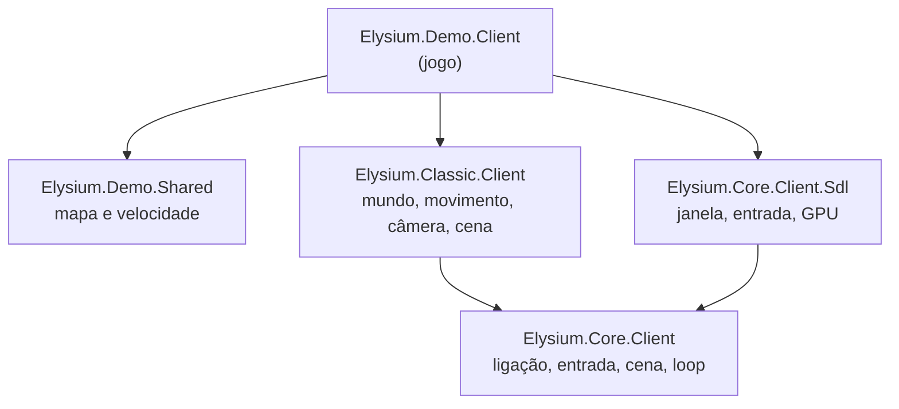
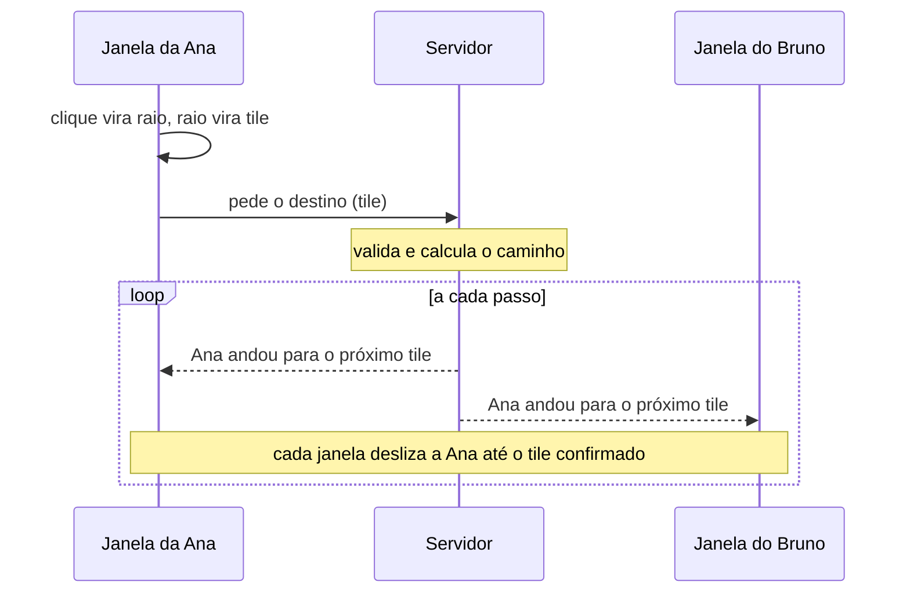

# Plano da fatia 1: Dois jogadores se veem

## Resumo para o dono

Primeiro entram os testes de mutação, que não dependem de nada novo. Depois um protótipo pequeno prova que a biblioteca gráfica funciona no seu computador, e você aprova a escolha (ADR 0012) antes de o cliente ser construído em cima dela. A lógica do cliente (estado do mundo, movimento suave, câmera e clique) é feita e testada sem janela; só no fim ela é ligada à janela de verdade e testada por dois clientes pela rede.

## Abordagem

1. **Testes de mutação (trava, P-0003).** O Stryker.NET entra como ferramenta local do repositório (`.config/dotnet-tools.json`), com a configuração para `Elysium.Core.Server` e `Elysium.Classic.Server`. Primeiro confiro se ele funciona com o xUnit v3 e o Microsoft Testing Platform deste repositório. Se não funcionar, **paro e pergunto**. Depois meço a nota atual de cada projeto, mostro os mutantes sobreviventes e ligo um job `mutation` na CI que falha abaixo do mínimo aprovado.
2. **Protótipo da biblioteca gráfica e ADR 0012.** O projeto `Elysium.Core.Client.Sdl` nasce com o mínimo: uma janela e um cubo desenhado pela GPU do SDL3 (D3D12 ou Vulkan, escolhido pelo SDL). O protótipo confere quatro coisas: se a biblioteca nativa do SDL3 vem no pacote, se o build continua compatível com NativeAOT, que ferramenta compila os shaders (os pequenos programas da placa de vídeo) e se a janela abre no seu computador. O resultado vira o ADR 0012. **Paro para a sua aprovação** do ADR e da ferramenta de shaders antes de seguir.
3. **Estado do mundo no Classic** (`Elysium.Classic.Client`). O `WorldView` sai do bot e vira o estado do mundo do cliente. Ele devolve mudanças tipadas (entrou, apareceu, andou, sumiu, destino recusado), e o bot passa a formatar o próprio texto. Resolve o TD-0004.
4. **Ligação com o servidor** (`Elysium.Core.Client`). A `GameConnection` passa a ser usada por uma ligação que lê e escreve em segundo plano. O loop de quadros só tira as mensagens já chegadas de uma fila, sem nunca esperar pela rede, e fica sabendo quando a conexão cai.
5. **Movimento suave** (`Elysium.Classic.Client`). Para cada entidade, guardo a fila de tiles confirmados pelo servidor e a posição desenhada, que avança na velocidade do jogo e nunca passa do último tile confirmado. Se o atraso passar de um limite, a posição alcança o servidor.
6. **Câmera 3/4 e clique** (`Elysium.Classic.Client`). Uma câmera de ângulo fixo segue um ponto, com os números (inclinação, distância e campo de visão) vindos do jogo. O clique vira um raio que sai da câmera, e o ponto onde esse raio cruza o chão dá o tile. A matemática usa o `System.Numerics`, que já vem com o .NET.
7. **Cena** (`Elysium.Core.Client` e `Elysium.Classic.Client`). O núcleo define a descrição da cena: câmera, luz e uma lista de blocos com posição, tamanho e cor. O Classic monta a cena a partir do mapa e do estado do mundo (chão, tiles bloqueados, personagens e marca do destino). Um teste mede que atualizar e montar a cena não aloca memória depois de aquecido.
8. **Renderização e entrada** (`Elysium.Core.Client.Sdl`). O protótipo vira o desenho da cena: um cubo só, desenhado muitas vezes de uma vez (instancing), com uma luz direcional simples. A janela traduz o mouse e o tamanho da janela para a entrada do núcleo. Um teste de arquitetura passa a exigir que só este projeto use o SDL.
9. **Jogo de demonstração.** Os dados que o servidor e o cliente compartilham (o mapa e a velocidade de um passo) vão para `samples/Elysium.Demo.Shared`. Nasce `samples/Elysium.Demo.Client`, com o nome pela linha de comando, as cores e os números da câmera, o login, o loop de quadros e o FPS no título.
10. **De ponta a ponta.** Um teste liga o servidor de demonstração e dois clientes sem janela, que usam a mesma lógica do cliente de verdade, pela rede: um clica, o outro vê o personagem andar até o tile certo, e um sai e some para o outro.
11. **Documentação.** ARCHITECTURE (projetos e cliente), um documento do módulo do cliente, o código de referência no CONVENTIONS, os itens provisórios no TECH_DEBT e o guia para tornar o check de mutação obrigatório.

## Projetos e módulos afetados

| Projeto | O que muda |
|---|---|
| `Elysium.Core.Client` | ligação com o servidor em segundo plano, entrada (mouse e janela), descrição da cena e o loop de quadros, que não conhece o SDL |
| `Elysium.Core.Client.Sdl` (novo, núcleo) | janela, entrada e GPU com o SDL3: desenha a cena e os shaders compilados |
| `Elysium.Classic.Client` (novo, Classic) | estado do mundo com mudanças tipadas, movimento suave, câmera 3/4, clique para tile e montagem da cena |
| `Elysium.Demo.Shared` (novo, jogo) | o mapa de demonstração e a velocidade de um passo, usados pelo servidor e pelo cliente |
| `Elysium.Demo.Server` | passa a ler o mapa e a velocidade de `Elysium.Demo.Shared` |
| `Elysium.Demo.Client` (novo, jogo) | o programa do cliente de demonstração |
| `tools/Elysium.Bot` | usa o estado do mundo do Classic e formata o próprio texto |
| `tests/Elysium.Core.Client.Tests`, `Elysium.Classic.Client.Tests`, `Elysium.Demo.Client.Tests` (novos) | testes da ligação, do estado do mundo, do movimento, da câmera, da cena e de ponta a ponta |
| `tests/Elysium.Architecture.Tests` (**trava**) | referências aos quatro projetos novos e a regra "só `Elysium.Core.Client.Sdl` usa o SDL" |
| `.github/workflows/ci.yml` (**trava**) | job `mutation` |
| `Directory.Packages.props` (**trava**) | versão do `ppy.SDL3-CS` |

O `Elysium.Core.Client.Sdl` é um projeto separado porque é o único que fala com o sistema operacional e com a placa de vídeo (INV-12). Assim, Linux e mobile mexem só nele. O `Elysium.Demo.Shared` nasce porque o servidor e o cliente precisam dos mesmos dados do jogo, e o cliente não pode depender do servidor (INV-02).

## Visão de destino

- **Plataforma:** o SDL3 já funciona em Windows, Linux, Android e iOS, com D3D12, Vulkan e Metal. Portar o cliente é ligar o SDL3 nessas plataformas, só no `Elysium.Core.Client.Sdl`. O toque do celular vira o mesmo "clique no chão" da entrada do núcleo.
- **Renderização:** a descrição da cena é dado, sem SDL: câmera, luz e o que desenhar. Hoje são só blocos coloridos. Ela vai ganhar malhas, materiais, personagens modulares com skinning na GPU, partículas e o forward+ da ARCHITECTURE, sempre do lado do `Elysium.Core.Client.Sdl`. O que é jogo continua sendo só a montagem da cena.
- **Loop de quadros sem alocação:** o teste que nasce agora é o mesmo que vai proteger a cena do cerco.
- **Ligação com o servidor:** leitura e escrita em segundo plano e uma fila tirada a cada quadro é o desenho definitivo. TLS entra por baixo, na `GameConnection`, que já trabalha com qualquer `Stream`.
- **Movimento suave:** a velocidade de cada entidade vai vir do servidor, porque monstros e efeitos mudam a velocidade (item provisório abaixo). A previsão de movimento no cliente só entra se uma medição pedir.
- **Câmera e clique:** os números da câmera já vêm do jogo. Na fatia 2, o clique passa a acertar também monstros e itens no chão (alvo), e não só o chão.
- **Estado do mundo:** as mudanças tipadas são o formato definitivo. Monstros, itens no chão e o inventário entram como novos tipos de mudança.
- **Testes de mutação:** começam pelos projetos de servidor, onde um teste fraco custa mais caro. Os projetos `*.Shared` e de cliente entram depois, se a retrospectiva decidir.

## Simplificações provisórias

| Item provisório | Por que é provisório | Destino |
|---|---|---|
| O cliente sabe a velocidade de um passo pelos dados compartilhados do jogo, e não pelo servidor | todos os personagens têm a mesma velocidade; com monstros, cada entidade tem a sua, e a mensagem de "apareceu" precisa trazê-la (nova versão do protocolo) | fatia 2 |
| O cliente lê o mesmo arquivo de mapa do servidor, embutido no programa, e o servidor não diz qual é o mapa | há um mapa só; o build de conteúdo (TD-0005) cria o pacote do cliente, e a entrada no mapa passa a dizer qual mapa é | fatia 2 |
| Shaders compilados à mão e guardados compilados no repositório, com o comando para refazê-los documentado | são dois ou três shaders; a compilação entra no build de conteúdo (TD-0005) | fatia 2 |

## Decisões e dependências

- **Biblioteca nova (precisa da sua aprovação): `ppy.SDL3-CS`.** É a ligação do C# com o SDL3, mantida pela equipe do osu!, com licença MIT. O SDL3, que ela traz, tem licença zlib, compatível com a MIT. O SDL3 cuida de janela, mouse, teclado e da GPU (D3D12, Vulkan e Metal). O ADR 0006 já apontava o SDL3 GPU como candidato. Alternativas: outra ligação do SDL3 para C# (pacote `SDL3-CS`), ou o Silk.NET, que é maior e cobre muito mais do que precisamos. O protótipo (passo 2) confirma a escolha antes de qualquer outro código depender dela.
- **Ferramenta de shaders (precisa da sua aprovação, no fim do protótipo):** o SDL3 GPU recebe os shaders já compilados para cada API gráfica. As candidatas são o SDL_shadercross, do próprio projeto SDL, e o DXC, da Microsoft. A escolha vem no ADR 0012.
- **Ferramenta nova (precisa da sua aprovação): Stryker.NET** (licença Apache 2.0). Ela só roda no desenvolvimento e na CI, e não vai junto com a engine. Para você decidir:
  - **Nota mínima:** proponho **80%** em cada projeto. Se a medição inicial ficar abaixo, eu mostro os mutantes sobreviventes e você escolhe entre melhorar os testes nesta fatia ou começar com a nota medida.
  - **Bloqueia ou só informa:** proponho que **bloqueie**. O job falha abaixo do mínimo, e você o torna obrigatório na regra da `main` no GitHub, num passo que eu descrevo no guia. Mudar configuração do GitHub é proibido para a IA.
- **ADR novo:** 0012, biblioteca de plataforma e gráficos.
- **Mudanças em travas (precisam da sua aprovação):**
  - `Directory.Packages.props`: a versão do `ppy.SDL3-CS`.
  - `tests/Elysium.Architecture.Tests`: as referências aos projetos novos (exigidas pelo teste de cobertura) e a regra nova "só `Elysium.Core.Client.Sdl` usa o SDL". As duas coisas **ampliam** a proteção.
  - `.github/workflows/ci.yml`: o job `mutation`.
- **VISION (precisa da sua aprovação):** a tabela do piso de hardware diz "confirmada na fatia 1". Proponho trocar para "confirmada na fatia de escala". Nesta fatia, o ADR 0012 confere que o SDL3 GPU funciona nas placas do piso (Intel UHD 620/630 e Radeon Vega 8 têm D3D12 e Vulkan), mas medir o FPS num PC mínimo só faz sentido com a cena do cerco.
- **Protocolo:** nenhuma mudança. O cliente usa a versão 1 da fatia 0 do jeito que ela está.
- **Banco de dados:** nenhuma mudança.

**Aprovado pelo dono em 2026-11-17, junto com a spec:** a biblioteca `ppy.SDL3-CS`; o Stryker.NET, com nota mínima de 80% em cada projeto, bloqueando o PR; as três mudanças em travas listadas acima; a mudança na VISION ("confirmada na fatia de escala"), feita na tarefa de documentação; e os destinos dos três itens provisórios. **Ainda pendentes** (parada no fim do protótipo): o ADR 0012 e a ferramenta de shaders.

## Riscos

- **O Stryker.NET pode não funcionar com o xUnit v3 4.x e o Microsoft Testing Platform.** Não encontrei confirmação oficial de que funcione. O passo 1 começa por essa conferência. Se falhar, paro e trago as opções, como ligar o modo de teste antigo (VSTest) só para ele ou adiar a P-0003.
- **Testes de mutação lentos na CI:** são só dois projetos, num job separado. Se passar de uns 15 minutos, trago a opção de rodar só quando o código de servidor mudar.
- **A GPU ou o driver do seu computador não funcionar com o SDL3 GPU:** o protótipo roda no seu computador antes de tudo, e é você quem confirma que a janela abriu com o cubo.
- **A ligação `ppy.SDL3-CS` é feita para o uso da própria equipe:** a versão fica fixa, e só o `Elysium.Core.Client.Sdl` a usa. Trocar de ligação mexe num projeto só.
- **Erros entre a rede e o loop de quadros:** a rede só coloca mensagens numa fila; o estado do mundo só muda no loop. Os testes do estado do mundo rodam sem rede e sem threads.
- **A CI não tem placa de vídeo:** nada que abre janela roda nos testes automáticos. Toda a lógica do cliente é testada sem janela, e o desenho é conferido por você (CA-11).
- **Fatia grande:** se a implementação mostrar que ela não cabe, os testes de mutação (passo 1) podem sair para uma fatia própria, com a sua aprovação.

## Testes

| Critério | Como é provado |
|---|---|
| CA-01 | teste da saída do login recusado no programa do cliente, em `Elysium.Demo.Client.Tests`; a janela e o terreno, por você (CA-11) |
| CA-02 | testes da câmera e do clique para tile (várias posições e tamanhos de janela), em `Elysium.Classic.Client.Tests`; de ponta a ponta, em `Elysium.Demo.Client.Tests` |
| CA-03 | testes do movimento suave com tempo controlado (velocidade, nunca passar do tile confirmado, alcançar quando atrasado), em `Elysium.Classic.Client.Tests` |
| CA-04 | teste do estado do mundo e da marca de destino recusado, em `Elysium.Classic.Client.Tests`; de ponta a ponta, em `Elysium.Demo.Client.Tests` |
| CA-05 | teste de ponta a ponta com dois clientes sem janela, pela rede, em `Elysium.Demo.Client.Tests`, rodando na CI em Windows e Linux |
| CA-06 | teste da ligação com o servidor fechando a conexão, em `Elysium.Core.Client.Tests`; o título, por você (CA-11) |
| CA-07 | teste de alocação de memória por quadro, em `Elysium.Classic.Client.Tests` |
| CA-08 | teste de arquitetura em `Elysium.Architecture.Tests` |
| CA-09 | testes do estado do mundo em `Elysium.Classic.Client.Tests` e os testes de ponta a ponta dos bots, que já existem, em `Elysium.Demo.Server.Tests` |
| CA-10 | job `mutation` da CI, com a nota de cada projeto no resultado do PR |
| CA-11 | verificação manual descrita em "Como o dono testa", na spec |

## Diagramas

Os projetos do cliente e quem depende de quem:

Um clique, do mouse até as duas janelas:

